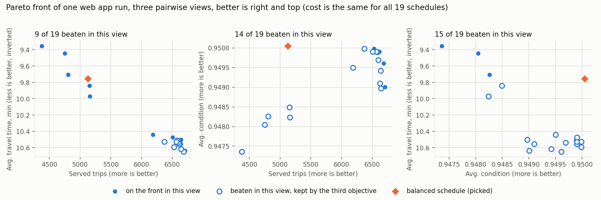
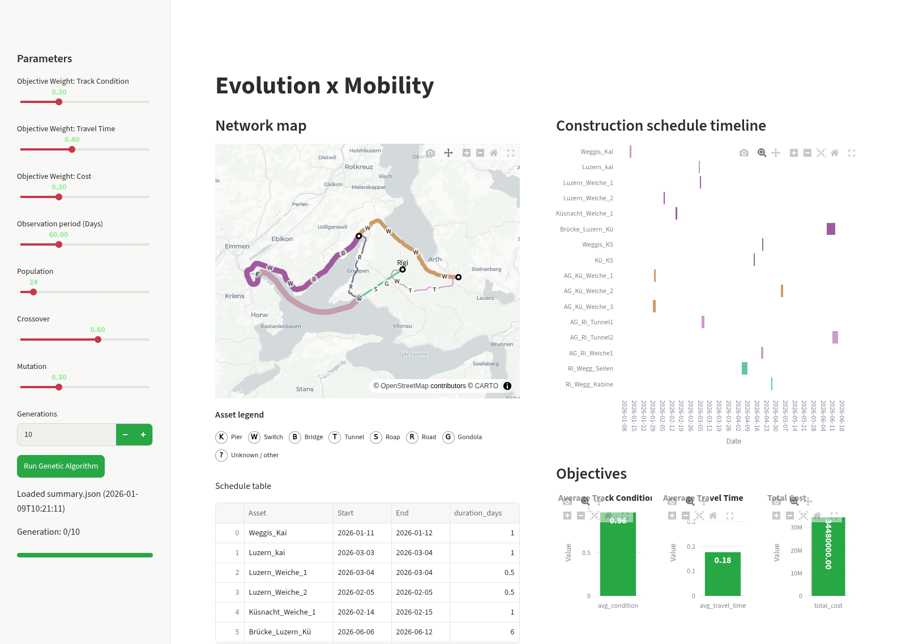
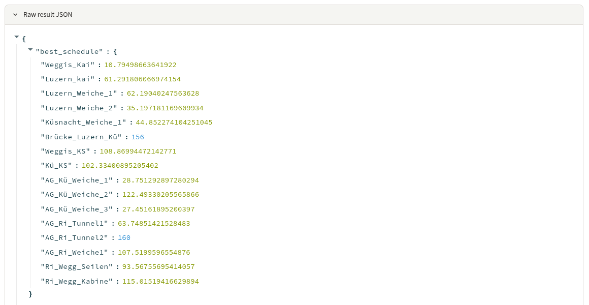
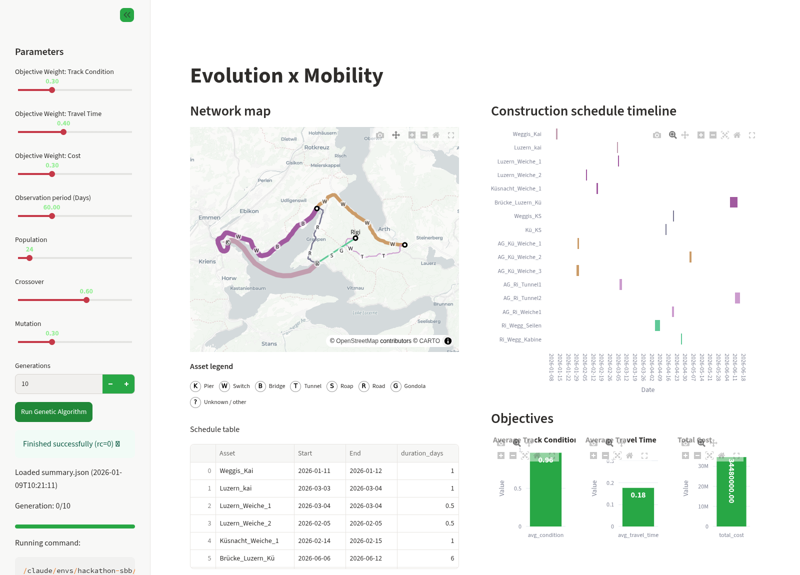
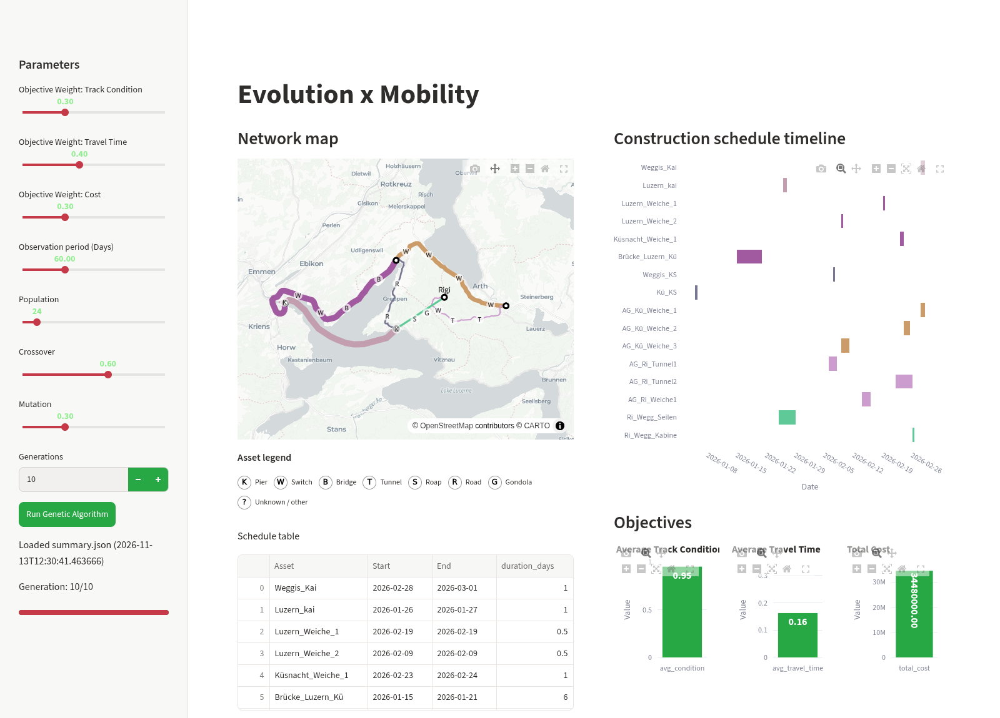
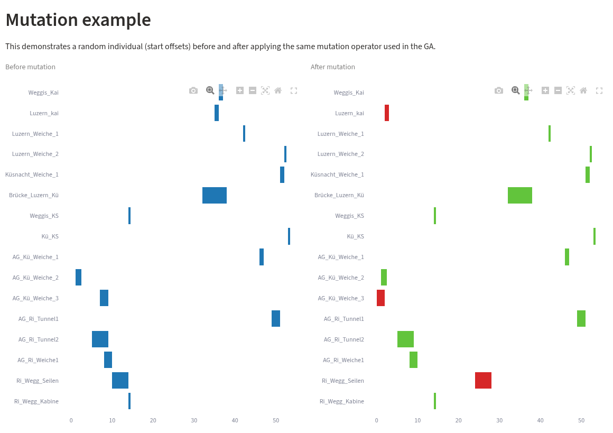
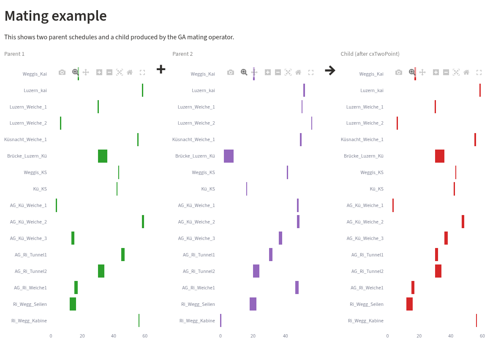
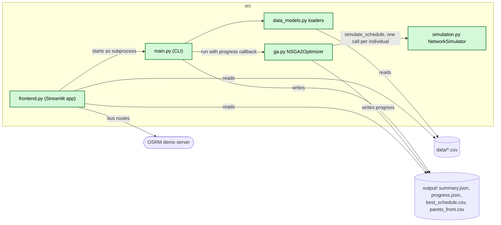
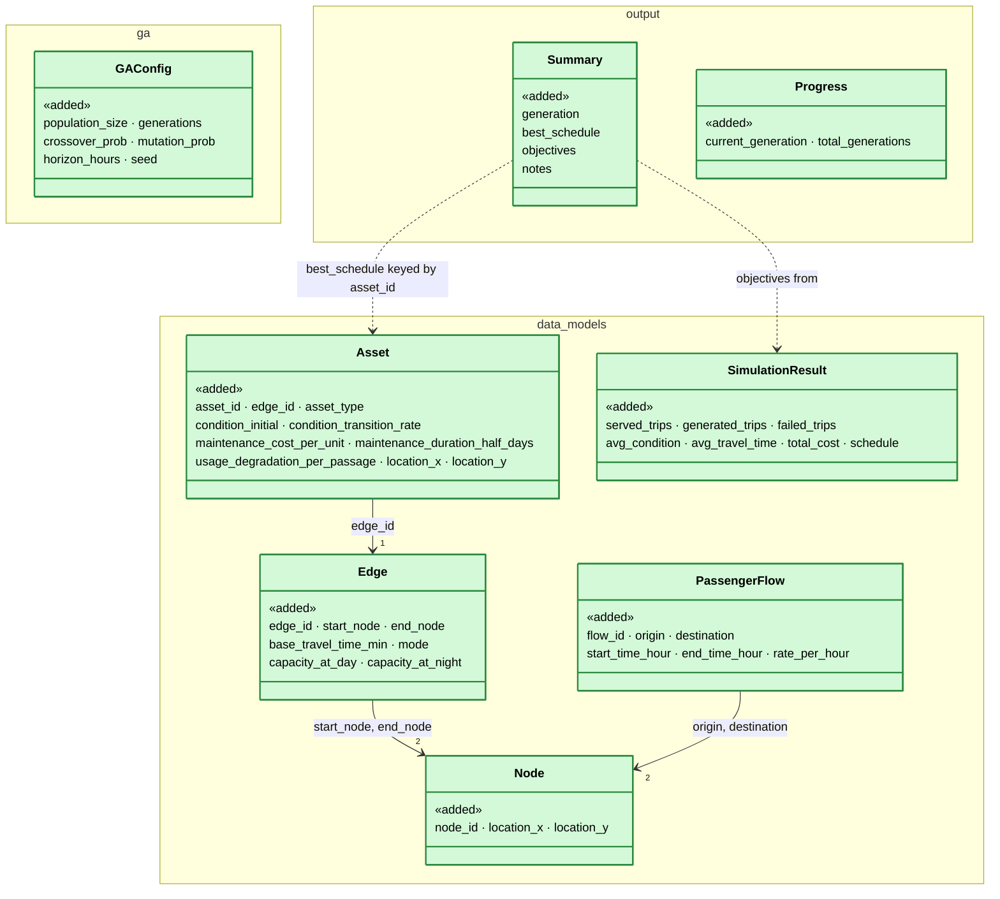
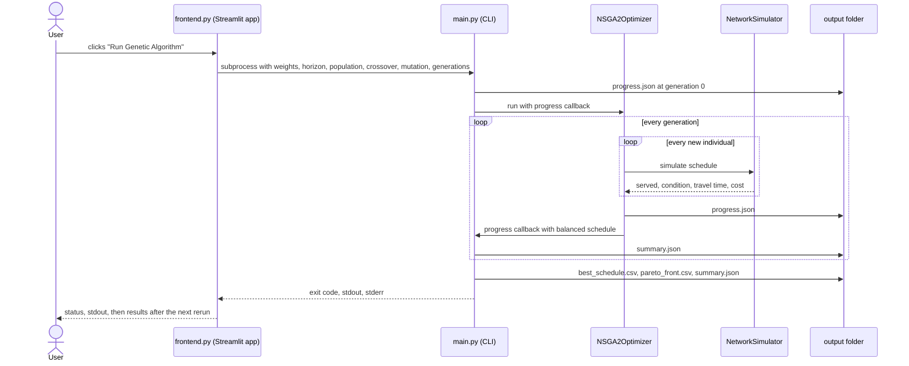

# Plan maintenance work on the Rigi public transport network with a genetic algorithm (as built)

> **Status:** plan of 2026-11-13, built by 2026-01-09. Describes `main` `550c032` as it is. Initial skeleton
> `f3163c2` ("Initial", 2026-01-08); everything after it was built at the hackathon "Hack the Tracks" on 2026-01-08
> and 2026-01-09 (PRs [#1](https://github.com/Biology-meets-Rigi/hackathon_sbb/pull/1)–[#4](https://github.com/Biology-meets-Rigi/hackathon_sbb/pull/4),
> all merged). No issue. This plan: branch `docs/maintenance-schedule-optimizer-plan`, PR
> [#5](https://github.com/Biology-meets-Rigi/hackathon_sbb/pull/5). Open questions: §9.1.
>
> **Why:** maintenance on quays, switches, tunnels, a bridge and a cable car around the Rigi closes or slows the
> lines passengers use. The team wanted to show that a genetic algorithm, scored by a passenger simulation, can find
> start times for this work that keep passengers moving, assets in good condition and cost low, and to make the
> algorithm visible to a jury in a web app.

## 1. Introduction and goals

*What the change is for: the requirements, the qualities that matter, who has a stake, and what it leaves out.*

### 1.1 Requirements overview (functional requirements)

*The issue's text and the numbered requirements the rest of the plan refers to.*

There is no issue. The requirements are read from the code and the commit history of `main` `550c032`:

- **REQ-1** Load the network (stations as nodes, lines as edges with mode, travel time and capacity), the assets on
  the edges and the passenger flows from CSV files in `data/`.
- **REQ-2** Simulate the passengers of one maintenance schedule: they route over the network, edges have limited
  capacity, assets degrade with time and use, and maintenance slows an edge down and halves its capacity.
- **REQ-3** Find maintenance start times with NSGA-II over four objectives (maximise served trips and average
  condition, minimise average travel time and total cost), keep the Pareto front and pick one balanced schedule
  from it.
- **REQ-4** Write the result after every generation (`output/summary.json`, `output/progress.json`) and at the end
  (`output/best_schedule.csv`, `output/pareto_front.csv`).
- **REQ-5** Show the result in a web app: the network on a map with its assets, the maintenance schedule as a
  timeline, the objectives as charts, the schedule table and the raw JSON.
- **REQ-6** Start an optimisation run from the web app with its parameters and show the generation reached.
- **REQ-7** Explain the GA's operators in the web app: a mutation and a mating example on random schedules.

### 1.2 Quality goals (non-functional requirements)

*The few qualities the design must reach, each with a concrete scenario.*

| ID | Priority | Quality goal | Scenario |
|---|---|---|---|
| NFR-1 | 1 | Demo-ready | A run with the web app's defaults (population 24, 10 generations) finishes during a live pitch. Not measured; `ga.py` prints `[BENCHMARK] Generation N completed in … seconds`. |
| NFR-2 | 2 | Reproducible | The same CLI arguments and `--seed` give the same schedule: random start times come from `random.seed(seed)`, each evaluation from `default_rng(seed + eval_counter)`, a different seed per evaluation (not common random numbers, §4.6). |
| NFR-3 | 3 | Readable for non-experts | A jury member sees on one page where the work happens (map), when (timeline) and what it costs the passengers (objectives). |

### 1.3 Stakeholders

*Who asks for the change, decides on it, reviews it or works with the result, and what they expect.*

| Role | Name | Expectations |
|---|---|---|
| Hackathon team (simulation, GA) | MLuuwak, ash | A true multi-objective optimiser, scored by a passenger simulation. |
| Hackathon team (frontend) | Elio (enwo02) | A map and timeline that make the result understandable. |
| Challenge owner and jury | "Hack the Tracks" (SBB) | A convincing idea for maintenance planning, shown live. |

### 1.4 Follow-ups (not in this PR)

*What this PR leaves out, why, and where it goes later.*

Everything below is left out of the hackathon build. Fixes for the limitations of §2.1 come first.

| Follow-up | Why not in this PR | From | Findings | Issue |
|---|---|---|---|---|
| Keep maintenance from blocking an edge for good: reduce its capacity without per-passenger slot reservations. | Found after the hackathon. | Limitations (L-1), Q-4 | - | - |
| One time unit for start times, durations and the horizon. | Found after the hackathon. | Limitations (L-2), Q-1 | - | - |
| Let the objective weights of the web app and `--weights` change which schedule is picked. | Not finished at the hackathon. | Limitations (L-3), Q-2 | - | - |
| Make total cost depend on the schedule, or drop it as an objective. | Found after the hackathon. | Limitations (L-4), Q-3 | - | - |
| Repeat the day's passenger flows over the whole horizon. | Found after the hackathon. | Limitations (L-5), Q-5 | - | - |
| Use night capacities and night flows. | Dropped in `5c104df` ("no more night flows"). | Limitations (L-6) (TODO) | - | - |
| Hard closures of an edge (e.g. a bridge replacement). | Prepared, disabled in `_get_blocked_edges`. | Limitations (L-7) | - | - |
| Show progress while a run is going on, and the new result when it ends. | Streamlit blocks during `subprocess.run`. | Limitations (L-8) | - | - |
| Validate the input CSV files: references between nodes, edges, assets and flows, unique IDs. | Found after the hackathon. | Limitations (L-12) | - | - |
| Accept `--generations 0`, or reject it in the argument parser. | Found after the hackathon. | Limitations (L-11) | - | - |
| Let maintenance improve condition: keep condition grades instead of cutting them to 1.0. | Needs a condition scale (with Q-1's units). | Limitations (L-13, L-9) | - | - |
| Pick parents by Pareto rank and crowding distance (`selTournamentDCD`). | Found after the hackathon. | Limitations (L-14) | - | - |
| Score travel time so that lost trips count: e.g. over generated trips, with a penalty for each trip not served. | Found after the hackathon. | Limitations (L-16) | - | - |
| Pick the balanced schedule on meaningful scales: fixed ranges per objective or weights (with Q-2). | Found after the hackathon. | Limitations (L-17), Q-2 | - | - |
| Control fitness noise: one seed for all individuals of a generation, served trips as a share of generated trips, or re-evaluation of the front. | Found after the hackathon. | Limitations (L-15) | - | - |
| Tests and CI. | Out of the hackathon's time. | §4.2 | - | - |
| List `streamlit` and `plotly<7` in `requirements.txt`, stop tracking `src/__pycache__/` and `output/best_schedule.csv`. | Out of the hackathon's time. | Assumptions | - | - |
| Import assets from the raw asset database (`data/Datenbank_ÖV_Modell.*`) and line geometries from `data/linie-mit-polygon.csv`. | The templates were filled by hand. | §12 | - | - |

## 2. Constraints

*What limits the design from outside: platform, organisation and conventions.*

| ID | Constraint | Kind | Explanation |
|---|---|---|---|
| C-1 | Two hackathon days. | Organisational | Built on 2026-01-08 and 2026-01-09; no tests, small populations and few generations. |
| C-2 | Python with `simpy`, `deap`, `pandas`, `numpy`, `openpyxl` (pinned in `requirements.txt`); `streamlit` and `plotly` (below 7) for the web app (not pinned). | Technical | The simulation is a `simpy` process model, the GA uses `deap`'s operators. |
| C-3 | Network data around the Rigi from public transport data. | Technical | Five stations, six edges (ship, train, cable car, bus), 16 assets; identifiers and some columns in German (`Kai`, `Weiche`, `Zug`, `Schiff`). |
| C-4 | Bus lines are drawn from the public OSRM demo server (`router.project-osrm.org`). | Technical | Needs internet; on error the web app draws no polyline for that edge. |
| C-5 | No repo instructions (`AGENTS.md`, `CLAUDE.md`, `CONTRIBUTING.md`). | Convention | This plan follows the flatland-association plan template. |

### 2.1 Limitations

*What the built code gets wrong or ignores, each with the TODO or issue that tracks it.*

The code keeps no list of its own; only L-6 has a `TODO`. L-1, L-4 and L-5 were checked by running
`NetworkSimulator` on the repo's data (2026-11-13, horizon 168 h, seed 1): all 16 assets at hour 150 gave 6547
generated and 6547 served trips; all at hour 1 gave 478 served and 6069 trips that never ended; cost 34,480,000
both times.

- **L-1 Maintenance can block an edge for the rest of the run.** During maintenance each passenger first reserves
  half of the edge's slots (`_traverse_edge`, `reserved = round(cap * (1 - maintenance_capacity_factor))`), one
  request at a time. Two passengers holding half each then wait for one more slot forever. Such trips count as
  neither served nor failed. No tracker.
- **L-2 Time units disagree.** The GA and the simulation treat a gene, `--horizon` and
  `maintenance_duration_half_days` as hours (`end_hour = start + maintenance_duration_half_days`). The web app
  passes its "Observation period (Days)" slider as `--horizon` and draws a gene as a day offset with a duration of
  `maintenance_duration_half_days / 2` days. No tracker.
- **L-3 Objective weights do nothing.** `main.py` parses `--weights` and the web app passes its three weight
  sliders, but `NSGA2Optimizer` never reads them: the balanced schedule is the one closest to the ideal point, with
  equal weights (`_choose_solution_from_pareto`). No tracker.
- **L-4 Total cost does not depend on the schedule.** Every asset is maintained exactly once, so `total_cost` is
  the same sum of `maintenance_cost_per_unit * maintenance_duration_half_days` for every individual: in effect
  three objectives. No tracker.
- **L-5 Passengers travel only on the first day.** `passenger_flows_day.csv` covers hours 0–24 and
  `_passenger_source` does not repeat it, so maintenance after hour 24 changes only the condition objective. No
  tracker.
- **L-6 Night capacities and night flows are not used.** `capacity_at_night` is loaded but `edge_resources` use
  `capacity_at_day` (`# TODO NAcht` in `simulation.py`); `passenger_flows_night.csv` is not read since `5c104df`.
- **L-7 No hard closures.** `_get_blocked_edges` always returns an empty set; the closure rule is commented out.
- **L-8 Progress and result are not live.** The web app runs `main.py` with a blocking `subprocess.run`; the
  progress bar reads `output/progress.json` and the page reads `output/summary.json` before the run starts, so
  both show the new state only when the page runs again: a reload or any widget change (§4.2, REQ-6).
- **L-9 Condition grades above 1 are cut to 1.** `condition_initial` holds grades 1 and 2 from the asset database
  (`Zustand`), while the simulation clamps condition to `[min_condition, 1.0]`.
- **L-10 The operator demos differ from the GA.** The mutation demo uses `indpb=0.2` (GA: `0.3`) and days (GA:
  hours); the GA mates only the best `crossover_prob` share of the population (`selBest`), the demo any two random
  schedules.
- **L-11 `--generations 0` crashes after the initial population.** `NSGA2Optimizer.run` reads `_gen` after the
  generation loop (`if _gen % 1 == 0`), which is unbound when the loop does not run (`UnboundLocalError`, checked
  2026-11-13). The web app allows 1 at least. No tracker.
- **L-12 The input files are not validated.** The loaders check neither references nor IDs (§5.7): an asset on an
  unknown edge fails only in the first simulation, a flow between unknown stations counts all its trips as failed
  without an error, and a duplicate ID replaces the earlier row: `assets_template.csv` has `Brücke_Luzern_Kü` twice,
  so the GA sees 16 of its 17 rows (§4.6). No tracker.
- **L-13 Maintenance lowers the condition of assets of grade 2 and above.** Their `condition_initial` is cut to 1.0
  and does not fall below it within the horizon; maintenance sets 0.2 during the window and 1.0 after it, from where
  it degrades. For 12 of the 16 assets the condition objective rewards maintenance as late as possible (§4.6). No
  tracker.
- **L-14 Parents are picked by served trips first.** `selBest` sorts by the weighted fitness values
  lexicographically (`deap.base.Fitness.__lt__`), not by Pareto rank and crowding distance (`selTournamentDCD` is
  commented out); the other objectives decide only on ties. No tracker.
- **L-15 Fitness noise is not controlled.** Every evaluation gets its own seed and an individual is never evaluated
  again, so on the plateau of §4.6 schedules are ranked by their demand draw, and a lucky draw stays. No tracker.
- **L-16 Losing trips shortens the average travel time.** `avg_travel_time` averages over served trips only, so a
  schedule that blocks an edge in the passenger hours (L-1) drops trips and looks faster; on the front of §4.6, fewer
  served trips go with shorter averages, and the balanced pick serves 24 % fewer trips than the best member. No
  tracker.
- **L-17 The balanced pick weighs noise-sized differences like real ones.** `_choose_solution_from_pareto` scales
  each objective to the range on the front, so the condition's range of 0.0027 counts as much as the served trips'
  2,300; with L-16 this picks a schedule that loses 24 % of the trips (§4.6). No tracker.

### 2.2 Assumptions

*What must hold for the design to be correct, but is not checked in code.*

Not checked in code; they hold by construction of the CSV files in `data/` and of the one-user demo.

- Every asset is maintained exactly once within the horizon; a gene is its start time.
- Every edge is used in both directions with the same travel time and capacity (`NetworkGraph.from_data`).
- `capacity_at_day` is the number of passengers on an edge at the same time (one `simpy.Resource` slot each).
- Passengers take the fastest route at their start time and do not reroute on the way.
- Each asset slows its edge down by its own condition; the edge takes the worst asset's condition.
- One run at a time: `main.py` and `ga.py` write fixed paths under `output/`, `ga.py` relative to the working
  directory (the web app sets `cwd` to the repo root).
- The web app runs where `streamlit` and `plotly` below 7 are installed (not in `requirements.txt`; plotly 7
  removed `go.Scattermapbox`) and has internet for OSRM and the map tiles.

## 3. Context and scope (checked 2026-11-13 on `main` `550c032`)

*The code on the base branch that the change works in, as it is before the change, and where the change stops.*

Context: the repo's inputs, which the code only reads.

- `data/nodes_template.csv`: five stations (Weggis, Luzern, Küsnacht am Rigi, Arth-Goldau, Rigi) with
  `location_x` = latitude, `location_y` = longitude.
- `data/edges_template.csv`: six edges with `mode` (`Schiff`, `Zug`, `Luftseilbahn`, `Bus`),
  `base_travel_time_min`, `capacity_at_day`, `capacity_at_night`.
- `data/assets_template.csv`: 16 assets (quays, switches, tunnels, a bridge, cable car rope and cabin) on the
  edges, with condition, degradation rate, cost and duration.
- `data/passenger_flows_day.csv`: twelve flows between station pairs, Poisson arrivals per hour, 0–12 h and
  12–24 h.
- `data/edge_paths_train.csv`: polylines for the train and ship edges on the map.
- Not read by the code: `data/Datenbank_ÖV_Modell.csv` and `.xlsx` (the raw asset database), `data/linie-mit-polygon.csv`
  (line geometries), `data/passenger_flows_night.csv`.

Scope: this plan describes everything in `src/` and the files it writes to `output/`. There was no code before the
skeleton `f3163c2`, so §3 has no current data model; the as-built model is in §5.

## 4. Solution strategy

*The fundamental choices and why, the rules the design follows, how it is verified, and the design of each part.*

| Quality goal | Scenario | Solution approach | Details |
|---|---|---|---|
| NFR-1 Demo-ready | A run finishes during the pitch. | Small defaults, a 5-station network, the web app starts the CLI. | §4.3, §4.5 |
| NFR-2 Reproducible | Same seed, same schedule. | Seeded `random` for the GA, one seeded `numpy` generator per evaluation. | §4.4 |
| NFR-3 Readable | One page shows where, when and what it costs. | Map, timeline and objective charts side by side, plus operator demos. | §4.5 |

### 4.1 Design principles

*The rules the design follows, each with its decision, the concepts it reuses instead of building new ones, and what
is not new on purpose.*

- **DP-1 True multi-objective, no weighted sum in the fitness.** The four objectives stay separate in the fitness
  and NSGA-II keeps the Pareto front; one schedule is picked from the front only at the end (`99dd66b`). Weights
  were meant to steer that pick (L-3, Q-2).
- **DP-2 The simulation is the fitness.** An individual is scored only by simulating its passengers; there is no
  analytic cost model.
- **DP-3 Files are the interface between optimiser and web app.** `main.py` writes JSON and CSV into `output/`; the
  web app reads them and starts `main.py` as a subprocess. No shared process, no server.
- **DP-4 The web app does not import the optimiser.** It only uses `deap.tools` for the operator demos.

Reused concepts:

| Need | Reused concept | Instead of |
|---|---|---|
| Multi-objective selection and Pareto archive | `deap.tools.selNSGA2`, `deap.tools.ParetoFront` | Own non-dominated sorting. |
| Crossover and mutation | `deap.tools.cxTwoPoint`, `deap.tools.mutPolynomialBounded` | SBX crossover (tried, commented out in `_setup_deap`). |
| Capacity and waiting | `simpy.Resource` per edge | Own queues. |
| Passenger arrivals | Exponential inter-arrival times (`rng.exponential`) | Fixed timetables. |
| Bus line geometry | OSRM `route` service | Hand-drawn polylines. |
| Web app | Streamlit with Plotly charts | A JavaScript frontend. |

Not new on purpose: no database, no web server of its own, no own routing graph library (Dijkstra in
`NetworkGraph.find_path`).

### 4.2 Verification

*How each requirement and quality goal is shown to work: tests, CI checks, before and after screenshots.*

Screenshots: taken 2026-11-13 of `main` `550c032` (as built, so there is no "before"), web app run with
`streamlit run src/frontend.py` (Streamlit 1.67.0, plotly 6.9.0) from a copy of the repo, so the run in REQ-6 did not
overwrite the committed `output/`; headless Chromium at 1600 px wide, map tiles from CARTO, bus lines from OSRM. With
plotly 7 the page stops at the map (`go.Scattermapbox` was removed), see §2.2. The repo has no tests and no CI.

| ID | Requirement | Test or check | Result | Screenshots |
|---|---|---|---|---|
| REQ-1 | Load the CSV files | Loaders run in the simulation check below and in the web app run. | ✅ | - |
| REQ-2 | Simulate a schedule | `NetworkSimulator` on the repo's data, two schedules (§2.1). | ⚠️ runs; L-1, L-4, L-5 found | - |
| REQ-3 | NSGA-II over four objectives | The run of REQ-6: its Pareto front in three pairwise views, drawn by `pareto_pairs_chart.py` (§4.6). The committed `output/` files are older than the code and data (§5.2). | ✅ 19 schedules on the front; the balanced pick serves 24 % fewer trips than the best member (L-16, L-17). | Pareto front:  |
| REQ-4 | Output files | Same files; the run of REQ-6 wrote all four, `progress.json` included. | ✅ | - |
| REQ-5 | Map, timeline, objectives | Page opened with the committed `output/summary.json`. | ✅ map with lines and lettered assets, timeline from 2026-01-01, three objective charts, schedule table, raw JSON. The timeline reaches into June although the observation period is 60 days (L-2). | overview: <br>raw JSON:  |
| REQ-6 | Start a run from the web app | "Run Genetic Algorithm" with the defaults (population 24, 10 generations). | ⚠️ the run finishes (rc=0), but the page keeps the old result and "Generation: 0/10" until it is reloaded (L-8). | running: <br>finished: <br>after reload:  |
| REQ-7 | Operator demos | Page opened, both demos on random schedules. | ✅ mutation before and after, mating of two parents into a child with `cxTwoPoint`; units and rates differ from the GA (L-10). | mutation: <br>mating:  |
| NFR-1 | Demo-ready | The run of REQ-6, timed in the browser. | ✅ 98 s in the sandbox (4–11 s per generation). | - |
| NFR-2 | Reproducible | By reading the code: all randomness of the CLI is seeded. | ✅ | - |
| NFR-3 | Readable | The hackathon jury (the repo is described as "Winning Team of Hack the Tracks"). | ✅ | - |

### 4.3 Command line run (REQ-1, REQ-3, REQ-4)

`src/main.py` loads the four CSV files, builds a `GAConfig` from its arguments and runs `NSGA2Optimizer`. It writes
`output/progress.json` (generation 0) before the run and `output/summary.json` after every generation through the
optimiser's `progress_cb`, then `output/best_schedule.csv`, `output/pareto_front.csv` and the final
`summary.json`. Run from the repo root:

```bash
python src/main.py --population 24 --generations 10 --horizon 168
```

### 4.4 Optimiser and simulation (REQ-2, REQ-3; DP-1, DP-2)

- An individual is a list of start times, one per asset in the order of `assets_template.csv`, bounded to
  `[0, horizon - duration]` (`_bounds_correction`).
- Each generation: the best `crossover_prob` share of the population (`selBest`, which compares fitness values
  lexicographically, L-14) is cloned, mated pairwise with
  `cxTwoPoint`, each child mutated with probability `mutation_prob`; `selNSGA2` picks the next population from
  parents and children.
- `_evaluate` simulates the schedule and returns `(served_trips, avg_condition, avg_travel_time, total_cost)`,
  weighted `(+1, +1, -1, -1)`.
- The balanced schedule is the Pareto member with the smallest Euclidean distance to the ideal point after
  normalising each objective to `[0, 1]`.
- In the simulation, an asset's condition falls by `condition_transition_rate` per day and by
  `usage_degradation_per_passage` per passenger (0 in the data), drops to at most 0.2 during its maintenance and
  is 1.0 after it. An edge's travel time is `base_travel_time_min * (2 - edge condition)`, times 1.5 during
  maintenance.

### 4.5 Web app (REQ-5, REQ-6, REQ-7; DP-3, DP-4)

`streamlit run src/frontend.py` shows, on one page:

- a sidebar with objective weights, observation period, population, crossover, mutation and generations, the
  "Run Genetic Algorithm" button and the generation reached;
- left: the network map (black and white map, edge width by `capacity_at_day`, train and ship edges from
  `edge_paths_train.csv`, bus edges from OSRM, assets as lettered markers);
- right: the "Construction schedule timeline" from 2026-01-01, coloured by edge, the "Objectives" bar charts and the
  "Schedule table";
- below: "Mutation example" and "Mating example" on random schedules, and the "Raw result JSON".

It falls back to a hard-coded sample result and hard-coded nodes and edges when a file cannot be read.

### 4.6 Optimisation problem, solution space and reward landscape (REQ-2, REQ-3)

*What the GA optimises, the space it searches and how the objectives behave in it, measured on the repo's data.*

**Problem.**
- Decision variables: one start time `sᵢ` per asset, 16 continuous genes in hours, bounded to `[0, H − dᵢ]` (`H`:
  horizon, 60 from the web app, 168 from the CLI; `dᵢ`: `maintenance_duration_half_days`, 1–12, read as hours, L-2).
  Each asset is maintained exactly once, in `[sᵢ, sᵢ + dᵢ)`; no other constraints, out-of-range genes are clamped.
- Objectives, from one stochastic simulation per evaluation (§5.3): maximise served trips and average condition,
  minimise average travel time (of served trips) and total cost.
- Result: the Pareto front and the balanced schedule (§4.4).

**Solution space.** A 16-dimensional box, 48–59 h wide per gene with the web app's horizon. Genes interact only
through their edge (worst-asset condition, maintenance slowdown): `L_K_Z` has 4 assets, `K_A_Z` and `R_A_Z` 3,
`W_L_S`, `W_K_B` and `W_R_L` 2 each. `assets_template.csv` has 17 rows, but `Brücke_Luzern_Kü` twice; the loader keeps
the second row (12 h, 1,000,000 per unit), which the constant cost of 34,480,000 confirms (L-12).

**Reward landscape.** Measured 2026-11-13 with `simulate_schedule`, `H` = 60: one schedule (all assets at 30 h) with
seeds 0–4, and `Weggis_Kai` (edge `W_L_S`) swept over 0–58 h with the other assets at 40 h, seed 1.

| `Weggis_Kai` start | Served | Avg. condition | Avg. travel time (h) |
|---|---|---|---|
| 0 | 3093 | 0.94837 | 0.1857 |
| 8 | 5241 | 0.94874 | 0.1794 |
| 12 | 6103 | 0.94890 | 0.1760 |
| 20 | 6424 | 0.94919 | 0.1760 |
| 24 and later | 6547, all generated | 0.94932 rising to 0.94980 at 58 | 0.1752 |
| all at 30, seeds 0–4 | 6547–6722 | 0.94808 for every seed | 0.1752–0.1773 |

- **Served trips: slope, then plateau.** Passengers travel only in hours 0–24 (L-5). A window starting then blocks
  its edge for the rest of the run (L-1), so the later it starts, the fewer trips are lost; the step at 12 h is the
  drop from the morning to the afternoon rates. From about 24 h on, every generated trip is served, whatever the
  schedule; the differences are the seed's demand draw (served = generated, about ±1.3 %).
- **Average condition: deterministic, smooth, small.** It does not depend on the seed. For the 12 assets of grade 2
  and above it rises the later the window (L-13); for the 4 of grade 1 a small concave gain peaks with the window
  ending around mid-horizon. The whole sweep moves it by 0.0015.
- **Average travel time: plateau plus noise.** It rises only with a window in the passenger hours; on the plateau
  the seed's noise (about 1 %) is larger than any difference between schedules.
- **Total cost: flat.** 34,480,000 for every schedule (L-4); it never decides between two schedules.

**Pareto front.** The front of the run of REQ-6 (horizon 60, population 24, 10 generations, seed 45: the web app's
defaults), kept in `maintenance-schedule-optimizer/pareto-front-2026-11-13.csv` and drawn by
`maintenance-schedule-optimizer/pareto_pairs_chart.py`, which marks the balanced pick as `_choose_solution_from_pareto`
does.

Why three pairwise views: the front lies in four objectives, of which cost is the same for every schedule, so it is a
set of points in three dimensions (served trips, condition, travel time). Any single 2D chart is a projection that
drops one objective, and the points that survive only through the dropped one then look beaten: 9 of 19 in served ×
travel time, 14 in served × condition, 15 in condition × travel time; in all three objectives none is. The three
views together show every objective against every other, and the balanced pick, which a served × travel time chart
cannot explain, is decided in the condition × travel time view. Axes where less is better are inverted, so better is
always right and top.


- 19 schedules, all with a cost of 34,480,000 and an average condition of 0.9474–0.9501.
- Served × travel time: two groups, many trips at about 10.5 min and fewer trips at 9.4–10.0 min. Fewer served trips
  go with a shorter average, because trips lost on blocked edges are not counted (L-16): losing passengers looks like
  faster travel.
- Condition × travel time: the balanced pick has the best condition of all 19 (0.95005) and, having lost trips, a
  short travel time; it is alone at the top right.
- The balanced pick serves 5126 trips, 24 % fewer than the best member. Its scaled distance to the ideal point is
  0.746 (gaps: served 0.68, condition 0.00, travel time 0.31), against 0.871 for the next one (6508 trips) and 1.063
  for the one with the most trips (6705): scaling every objective to [0, 1] gives the condition's range of 0.0027,
  about the size of the noise, the same weight as 2,300 trips (L-17).

**What follows for the GA.**
- The optimum of the model is trivial: every window after the passenger hours and as late as possible, i.e.
  maintenance postponed to the end of the horizon. This comes from the model (L-5, L-13), not from maintenance
  planning.
- On the plateau, served trips and travel time rank schedules by their demand draw: every evaluation has its own
  seed (`seed + eval_counter`), which is not "common random numbers", and an individual is never evaluated again,
  so a lucky draw stays (L-15).
- Parents are chosen by served trips first (L-14), the noisiest objective on the plateau; the condition, the only
  signal free of noise, decides only on ties.
- The committed run (horizon 168) has starts from 10 h to 160 h: ten generations of 24 individuals do not converge
  against this noise in 16 dimensions.

## 5. Building block view

*The components the change adds or changes: an overview, why the system is split this way, what each is responsible
for, the important interfaces, and the planned data model.*

### 5.1 Optimiser and web app

*One white box: its building blocks, why it is split this way, and the interfaces between them.*



Notation: [flowchart in Mermaid](https://mermaid.js.org/syntax/flowchart.html); green: added (all of `src/` is new
compared with an empty repo), cylinders: files, rounded: external service.

**Motivation:** the optimiser is a plain CLI so it runs without the web app (DP-3); the simulation is separate from
the GA so the fitness can be swapped or tested alone (DP-2); the web app only reads files and starts the CLI
(DP-4).

**Contained building blocks:**

| Component | Responsibility | Change |
|---|---|---|
| `data_models` | Reads the network, assets and flows from CSV into typed records. Not for validation or derived data. | 🟩 added: the scenario is edited in CSV files, not in code. |
| `NetworkSimulator` | Scores one maintenance schedule by simulating the passengers. Not for choosing schedules. | 🟩 added: a schedule gets served trips, condition, travel time and cost. |
| `NSGA2Optimizer` | Searches start times and keeps the Pareto front, picks one balanced schedule. Not for reading or writing files, except `progress.json`. | 🟩 added: the user gets a set of trade-offs and one recommended schedule. |
| `main.py` | Command line entry: arguments, loading, writing the output files. Not for display. | 🟩 added: a run is one command. |
| `frontend.py` | Shows the network, the schedule and the objectives, starts runs and explains the operators. Not for computing schedules. | 🟩 added: a non-expert sees and starts the optimisation in the browser. |

**Important interfaces:** the CLI arguments of `main.py` (§4.3, called by `frontend.py`), the files in `output/`
(§5.2), the fitness call from `NSGA2Optimizer` to the simulation (§5.3), the run call from `main.py` to
`NSGA2Optimizer` (§5.4), the subprocess call from `frontend.py` to `main.py` (§5.5), the records the simulation
reads from `data_models` (§5.6) and the loaders `main.py` calls (§5.7).

### 5.2 Data model: as built

*The records read from `data/` and the files written to `output/`.*

Source files: `src/data_models.py`, `src/ga.py`, `src/simulation.py`, `src/main.py`.



Notation: [UML class diagram in Mermaid](https://mermaid.js.org/syntax/classDiagram.html); `Summary` is
`output/summary.json`, `Progress` is `output/progress.json` (no classes in the code). Green «added»: new compared
with an empty repo.

`output/summary.json` (shortened, values from the committed file):

```json
{
  "best_schedule": { "Weggis_Kai": 10.79, "Luzern_kai": 61.29 },
  "objectives": {
    "served_adjusted": 13248.0,
    "avg_condition": 0.964,
    "avg_travel_time": 0.177,
    "total_cost": 34480000.0
  },
  "notes": ["Objectives are true multi-objective (NSGA-II): …"]
}
```

`output/progress.json`: `{"current_generation": 3, "total_generations": 10}`. `output/best_schedule.csv` has
`asset_id,start_hour`; `output/pareto_front.csv` has the four objectives and `genes` (a JSON list in asset order).
The committed output files are older than the code and the data, so they are no evidence for REQ-3 (§4.2 uses
the run of REQ-6 instead): `summary.json` (`54fcbf6`, 2026-01-08) has no `generation` field and twice the trips of
one day, from before the night flows were dropped (`5c104df`); `pareto_front.csv` (`99dd66b`) has 4 genes and a cost of
3,780,000, from an older asset list. `served_adjusted` equals
`served_trips` (the failure penalty is commented out); the web app hides it.

### 5.3 `ga.py` ↔ `simulation.py` interface

*How `NSGA2Optimizer` scores an individual: the one call into the simulation and what comes back.*

`ga.py` imports only `simulate_schedule` from `simulation.py` and calls it once per individual in `_evaluate`;
`NetworkSimulator`, `NetworkGraph` and `MaintenanceWindow` stay inside `simulation.py` (DP-2). Each call builds a new
`NetworkSimulator`, runs it up to the horizon and returns a `SimulationResult` (§5.2), so no state carries over between
evaluations.

```python
def simulate_schedule(nodes, edges, assets, flows, schedule, rng, horizon_hours=24.0) -> SimulationResult
```

| Parameter or result | `NSGA2Optimizer` passes or uses | Note |
|---|---|---|
| `nodes`, `edges`, `assets` | The loaded `Node`, `Edge` and `Asset` dicts, the same for every call. | |
| `flows` | The day's flows (`flows_day`). | L-5, L-6 |
| `schedule` | `{asset_id: start}`: the genes in the order of `assets_template.csv`, after `_bounds_correction`. | Hours, the web app draws days (L-2). |
| `rng` | `default_rng(seed + eval_counter)`: a new seed per call. The code calls it "common random numbers", but individuals are scored with different seeds (L-15, §4.6). | NFR-2 |
| `horizon_hours` | `GAConfig.horizon_hours`. | L-2 |
| `SimulationResult` | The fitness `(served_trips, avg_condition, avg_travel_time, total_cost)`, weighted `(+1, +1, -1, -1)`; `generated_trips` and `failed_trips` only in the log every 50 calls; `schedule` unused. | `total_cost` is the same for every schedule (L-4). |

### 5.4 `main.py` ↔ `ga.py` interface

*How the command line starts a run: what `main.py` hands to `NSGA2Optimizer`, and what it gets back during and after
the run.*

`main.py` imports `GAConfig` and `NSGA2Optimizer` from `ga.py`. It loads the CSV files, builds the config from its
arguments, constructs the optimiser and calls `run` once, with `_write_summary` as the progress callback:

```python
NSGA2Optimizer(nodes, edges, assets, flows_day, config: GAConfig)
NSGA2Optimizer.run(progress_cb=None) -> (best_schedule, best_metrics, pareto)
progress_cb(generation, best_schedule, best_metrics, pareto) -> None
```

| Parameter or result | `main.py` passes or uses | Note |
|---|---|---|
| `nodes`, `edges`, `assets`, `flows_day` | The results of the `data_models` loaders on `--nodes`, `--edges`, `--assets`, `--flowsday`; handed on unchanged to `simulate_schedule` (§5.3). | The order of `assets` is the gene order. |
| `GAConfig` | `population_size` ← `--population`, `generations` ← `--generations`, `crossover_prob` ← `--cx`, `mutation_prob` ← `--mut`, `horizon_hours` ← `--horizon`, `seed` ← `--seed`. | `--weights` is parsed but not passed (L-3). The `GAConfig` defaults (e.g. horizon 730) differ from the CLI defaults (168); only the CLI's apply. |
| `progress_cb` | `_write_summary`: writes `summary.json` next to `--output` for generation 0 (after the first evaluation) and after every generation; ignores `pareto`. | The callback runs inside the GA loop; `ga.py` itself writes `output/progress.json` (relative to the working directory) at the same point. |
| `best_schedule` | `{asset_id: start}` of the balanced Pareto member (`_choose_solution_from_pareto`), saved to `--output` (`best_schedule.csv`) and the final `summary.json`. | Start times in hours (L-2). |
| `best_metrics` | Its fitness `(served_trips, avg_condition, avg_travel_time, total_cost)`, written as `objectives` with `served_trips` named `served_adjusted`. | |
| `pareto` | The `deap` `ParetoFront` of all generations, saved to `--pareto_out` (`pareto_front.csv`) with the genes as a JSON list. | |

Before `run`, `main.py` writes `progress.json` with generation 0; after it, the final `summary.json`. All other output
files come from `main.py` too: `NSGA2Optimizer` writes only `progress.json` (§5.1).

### 5.5 `frontend.py` ↔ `main.py` interface

*How the web app starts a run and gets its result: a subprocess call one way, files the other way.*

There is no Python import between them (DP-3, DP-4): when "Run Genetic Algorithm" is clicked, `frontend.py` runs
`main.py` as a blocking `subprocess.run` with the Python interpreter of the web app and `cwd` set to the repo root, and
reads the result from the files in `output/` (formats in §5.2) when the page is rendered.

```bash
python src/main.py --weights <w1> <w2> <w3> --horizon <days> --population <n> --cx <p> --mut <p> --generations <n>
```

| Direction | What | Note |
|---|---|---|
| web app → `main.py` | `--weights`: the three weight sliders, normalised to sum 1. | Has no effect (L-3). |
| web app → `main.py` | `--horizon`: the "Observation period (Days)" slider. | `main.py` reads hours (L-2). |
| web app → `main.py` | `--population`, `--cx`, `--mut`, `--generations`: the sliders and the number input. | |
| web app → `main.py` | Not passed: `--seed` (CLI default 45), the input paths and `--output`/`--pareto_out` (defaults under `data/` and `output/`). | Every run from the web app uses the same seed. |
| `main.py` → web app | Return code, stdout and stderr: shown as success or error and in the "Stdout"/"Stderr" expanders. | |
| `main.py` → web app | `output/summary.json`: `best_schedule` drives the timeline (start times read as days from 2026-01-01) and the schedule table, `objectives` the charts; `served_adjusted` is dropped. | Read before the run starts, so the new result shows only after a reload (L-8). If it cannot be read, the page falls back to a hard-coded sample. |
| `main.py` → web app | `output/progress.json`: the sidebar's "Generation: n/N" and progress bar. | Same timing (L-8). |
| - | `output/best_schedule.csv`, `output/pareto_front.csv`: not read by the web app. | |

### 5.6 `data_models.py` ↔ `simulation.py` interface

*Which fields of the records in §5.2 the simulation reads, what it does with them, and what it gives back.*

`simulation.py` imports the record classes `Node`, `Edge`, `Asset`, `PassengerFlow` and `SimulationResult` from
`data_models.py`, not the loaders: the records come in through `simulate_schedule` (§5.3), loaded by `main.py` (§5.4).
The simulation only reads them; its changing state (condition after maintenance, last maintenance, resources) lives
in `NetworkSimulator`, so the shared records stay the same across evaluations.

| Record | Fields the simulation reads | Used for | Note |
|---|---|---|---|
| `Node` | none, only the keys of `nodes` | The nodes of the routing graph (`NetworkGraph.from_data`). | `location_x`, `location_y` only in the web app. |
| `Edge` | `start_node`, `end_node` | Both directions of the edge in the routing graph. | Assumption: same in both directions (§2.2). |
| `Edge` | `base_travel_time_min` | Travel time and routing weight, `/ 60 * (2 - condition)`, `* 1.5` during maintenance. | |
| `Edge` | `capacity_at_day` | Slots of the edge's `simpy.Resource` (at least 1). | `capacity_at_night` unused (L-6). Maintenance blocking (L-1). |
| `Edge` | `mode` | not read | Only in the web app. |
| `Asset` | `edge_id` | Which edge the asset slows down (worst asset condition per edge). | |
| `Asset` | `condition_initial` | Condition before the first maintenance. | Grades above 1 are cut to 1 (L-9). |
| `Asset` | `condition_transition_rate` | Loss of condition per day. | |
| `Asset` | `usage_degradation_per_passage` | Loss of condition per passenger on the edge. | 0 in the data. |
| `Asset` | `maintenance_duration_half_days` | Maintenance window `[start, start + duration)`, read as hours, and cost. | L-2 |
| `Asset` | `maintenance_cost_per_unit` | `total_cost += cost_per_unit * duration`. | Same for every schedule (L-4). |
| `Asset` | `asset_type`, `location_x`, `location_y` | not read | `asset_type` only in the disabled hard closure (L-7). |
| `PassengerFlow` | `origin`, `destination` | Start and end node of each trip. | |
| `PassengerFlow` | `start_time_hour`, `end_time_hour`, `rate_per_hour` | Poisson arrivals with `rate_per_hour` between the two hours, cut at the horizon. | Not repeated after day 1 (L-5). |
| `PassengerFlow` | `flow_id` | not read | |
| `SimulationResult` | all fields, written | Returned by `NetworkSimulator.run`; `schedule` is the start times it was given. | Used by `NSGA2Optimizer` (§5.3). |

### 5.7 `data_models.py` ↔ `main.py` interface

*How the command line turns the CSV files into the records of §5.2.*

`main.py` imports only the four loaders from `data_models.py` and calls each once, with the paths from its arguments;
it hands the results on unchanged to `NSGA2Optimizer` (§5.4). It writes the output files itself, without
`data_models`. `frontend.py` does not use the loaders: it reads `nodes_template.csv`, `edges_template.csv`,
`assets_template.csv` and `edge_paths_train.csv` with its own `pandas` code.

```python
load_nodes(path) -> Dict[str, Node]                    # --nodes    data/nodes_template.csv
load_edges(path) -> Dict[str, Edge]                    # --edges    data/edges_template.csv
load_assets(path) -> Dict[str, Asset]                  # --assets   data/assets_template.csv
load_passenger_flows(path) -> List[PassengerFlow]      # --flowsday data/passenger_flows_day.csv
```

| Loader | Returns | Note |
|---|---|---|
| `load_nodes` | `{node_id: Node}`; the CSV's columns, one record per row. | `location_x` holds the latitude, `location_y` the longitude. |
| `load_edges` | `{edge_id: Edge}`. | Reads a `bidirectional` column if there is one, but does not use it: every edge is two-way (§2.2). `base_travel_time_min` becomes a float although the field is typed `int`. |
| `load_assets` | `{asset_id: Asset}`, in the CSV's row order. | That order is the gene order of the GA (§5.3). `usage_degradation_per_passage` is optional and 0 when the column is missing, as in the data. |
| `load_passenger_flows` | `[PassengerFlow]`. | `main.py` loads only the day flows (L-6). |

The loaders do not validate references or IDs:
- a missing column raises a `KeyError` in the loader;
- an edge with an unknown node or an asset with an unknown `edge_id` raises a `KeyError` only in the first simulation
  (`NetworkGraph.from_data`, `NetworkSimulator.__init__`);
- a flow with an unknown origin or destination raises nothing: each of its trips counts as failed (`find_path`
  returns `None`);
- a duplicate ID silently replaces the earlier row.

## 6. Runtime view

*How the components work together at runtime: the flows and modes the change adds or changes, when it changes behaviour.*

### 6.1 A run started from the web app (REQ-4, REQ-6)

*One flow or mode, as a sequence or state diagram.*



Notation: [sequence diagram in Mermaid](https://mermaid.js.org/syntax/sequenceDiagram.html).

## 8. Crosscutting concepts

*What the change introduces that other code will follow, and what it changes for existing callers.*

### 8.1 New patterns

*What is new compared with the base branch.*

Compared with an empty repo; everything is new. What is reused, and what is not new on purpose, is in §4.1.

| ID | New | Defined in |
|---|---|---|
| PAT-1 | Simulation-based fitness with one seeded random generator per evaluation. | §4.4, §4.6 |
| PAT-2 | Files in `output/` as the only interface between optimiser and web app, besides the command line that starts a run. | DP-3, §5.2, §5.5 |
| PAT-3 | A colour per edge, shared by map and timeline (`_hex_color_from_string`). | §4.5 |

### 8.2 Breaking changes

*What breaks for whom, and the migration path.*

None: there are no callers outside the repo. Within it, the web app keeps reading `weighted_objectives` from older
`summary.json` files as `objectives`.

## 9. Decisions

*The decisions behind the plan: the questions still open, the decisions taken, and how each review finding was settled.*

### 9.1 Open questions

*Choices not made yet, each with its options and a proposal.*

The team decides; they are open only if the project goes on after the hackathon.

💡 **(Q-1) Which time unit do genes, durations and the horizon use? (L-2)**
- a) Hours everywhere: the web app converts its days slider to hours and draws genes as hours;
  `maintenance_duration_half_days` is multiplied by 12 in the simulation and the GA bounds.
- b) Days everywhere: the simulation converts to hours inside.

*Proposal:* a), the simulation already runs in hours and the flows are per hour.

💡 **(Q-2) What do the objective weights do? (L-3)**
- a) Remove the weight sliders and `--weights`; keep the unweighted distance to the ideal point.
- b) Pass the weights to `_choose_solution_from_pareto` as a weighted distance; the Pareto front stays unweighted
  (DP-1 holds).

*Proposal:* b), the sliders are part of the demo and DP-1 is kept.

💡 **(Q-3) How does cost become an objective that depends on the schedule? (L-4)**
- a) Drop `total_cost` as an objective.
- b) Make it depend on the schedule, e.g. a gene may mean "not in this horizon", or cost grows with the condition at
  the start of the work.

*Proposal:* a) until there is data for b).

💡 **(Q-4) How does maintenance reduce an edge's capacity? (L-1)**
- a) A second `simpy.Resource` per edge with `capacity * maintenance_capacity_factor`, used while maintenance is
  on.
- b) Treat capacity as passengers per hour with a token bucket (`simpy.Container`), as the data likely means.

*Proposal:* a), smallest change that removes the deadlock; b) together with Q-5.

💡 **(Q-5) Do the day's flows repeat over the horizon? (L-5)**
- a) Repeat `passenger_flows_day.csv` every 24 hours.
- b) Keep one day and limit the horizon to it.

*Proposal:* a), otherwise most of the horizon has no passengers.

### 9.2 Decision log

*Every decision by date, with why it was taken and what follows from it.*

Read from the commit history; the decisions were taken at the hackathon without questions.

| Date | Decision | Why | Consequences |
|---|---|---|---|
| 2026-01-08 | ✅ True multi-objective NSGA-II instead of a weighted sum in the fitness (`99dd66b`). | Weights hide trade-offs; the Pareto front shows them. | DP-1; the weights lost their effect (L-3, Q-2). |
| 2026-01-08 | ✅ The web app reads `output/summary.json` and starts `main.py` as a subprocess (PR #2, `a02595a`). | Optimiser and web app were built in parallel by different people. | DP-3; progress is not live (L-8). |
| 2026-01-08 | ✅ Day flows only (`5c104df`). | Simpler model for the demo. | L-6. |
| 2026-01-09 | ✅ Polylines for trains and ships from a CSV, for buses from OSRM (PR #4). | Straight lines did not look like the network. | C-4. |
| 2026-01-09 | ✅ `cxTwoPoint` and `mutPolynomialBounded` instead of SBX crossover (`3f30dfb`). | Easier to explain in the operator demos. | REQ-7. |

### 9.3 Code Review Findings

*Findings from code reviews, PR comments and TODOs, with their status and the commits that fix them.*

None recorded. The PRs #1–#4 have no review comments; the gaps found while writing this plan are in §2.1.

## 10. Glossary

*The domain and technical words the plan uses, with their code symbols.*

- **Node** (`Node`): a station. Not a stop on the map between stations.
- **Edge** (`Edge`, `edge_id`): a line between two stations with one mode (`Zug` train, `Schiff` ship,
  `Luftseilbahn` cable car, `Bus`), used in both directions.
- **Asset** (`Asset`, `asset_id`; "Anlage" in the database): a piece of infrastructure on an edge that needs
  maintenance (`Kai` quay, `Weiche` switch, tunnel, bridge, `Seilen` rope, `Kabine` cabin).
- **Condition** (`condition_*`, `avg_condition`): an asset's state, 1.0 as new; `Zustand` in the database (grades,
  L-9).
- **Maintenance window** (`MaintenanceWindow`): the hours an asset is under maintenance; in this repo always exactly
  one per asset.
- **Passenger flow** (`PassengerFlow`): Poisson arrivals between two stations in an hour range. `flow_id` is not
  unique (one id per station pair and half-day).
- **Schedule** (`best_schedule`, an individual): the start time of every asset's maintenance. Gene: one start
  time.
- **Horizon** (`horizon_hours`, `--horizon`, "Observation period (Days)"): the simulated time span; unit unclear
  (L-2).
- **Pareto front** (`tools.ParetoFront`, `pareto_front.csv`): the schedules no other one beats in all objectives.
- **Balanced schedule**: the Pareto member closest to the ideal point (§4.4). Not a weighted optimum.
- **Served trips** (`served_trips`, `served_adjusted`): trips that reached their destination within the horizon.

## 11. Execution plan and status

*The commits that build the change, in order, and which of them are done: the source of the PR's status.*

### 11.1 Steps

*One row per commit: what it does, the findings it fixes, its message, and its SHAs once committed.*

The hackathon's commits, grouped; messages as they were.

| ID | Findings | Step | Category | Severity | Commit message | Commit(s) | Needs | Blocked by |
|---|---|---|---|---|---|---|---|---|
| ✅ S-1 | - | Skeleton: data templates, loaders, simulation, GA, CLI. | feature | - | Initial | f3163c2 | - | - |
| ✅ S-2 | - | Scenario data: nodes, passenger flows, edges, assets, models. | feature | - | nodes · passenger flows · edges · assets · models | c607440 89e09d3 1356256 94b4d6e a2b3b82 | S-1 | - |
| ✅ S-3 | - | True multi-objective NSGA-II. | feature | - | Echtes Multi-Objective NSGA-II (keine Gewichts-Vermischung in der Fitness) | 99dd66b | S-1 | - |
| ✅ S-4 | - | Web app: map, timeline, layout, edge width. | feature | - | Frontend v0 · import nodes works · import edges works · thickness of edges · changed layout · schedule table fixed | 03a33df 6dd75a7 1108b46 d2e96f0 627d507 bd6d99f | S-2 | - |
| ✅ S-5 | - | Web app reads `summary.json`, starts runs, shows progress (PRs #1–#3). | feature | - | read from json in frontend · button · auto refresh backend · repeat · refresh | 54fcbf6 a02595a 44c9178 8faab82 a7caf6b | S-3, S-4 | - |
| ✅ S-6 | - | Day flows only. | refactor | - | no more night flows | 5c104df | S-2 | - |
| ✅ S-7 | - | Line geometries and asset markers on the map (PR #4). | feature | - | lines look nice · bus lines nice · bw map · show assets · visual adjustements | b556497 c6e351b 3619e7d 033057f a29dbaf | S-4 | - |
| ✅ S-8 | - | Mutation operator and operator demos, objective charts. | feature | - | normal mutation · show mutation example in frontend · mating example in frontend · better objectives in frontend · green frontend · small changes · show mutations | 3f30dfb 8df77f6 25ede03 db21ed3 58bfd0e 34b512b 550c032 | S-3, S-5 | - |

## 12. Change inventory

*Every file the change adds, modifies, renames or removes, and what stays unchanged on purpose.*

### 12.1 New files

*The files the change adds, and what each adds.*

| File | Adds |
|---|---|
| `src/data_models.py` | `Node`, `Edge`, `Asset`, `PassengerFlow`, `SimulationResult`, `load_*` CSV loaders. |
| `src/simulation.py` | `MaintenanceWindow`, `NetworkGraph` (Dijkstra), `NetworkSimulator`, `simulate_schedule`. |
| `src/ga.py` | `GAConfig`, `NSGA2Optimizer` (`run`, `_evaluate`, `_choose_solution_from_pareto`), writes `output/progress.json`. |
| `src/main.py` | CLI, `save_schedule`, `save_pareto`, `summary.json` per generation. |
| `src/frontend.py` | Streamlit app: map, timeline, objectives, schedule table, run button, operator demos. |
| `data/*_template.csv`, `data/passenger_flows_*.csv`, `data/edge_paths_train.csv` | The scenario (§3). |
| `data/Datenbank_ÖV_Modell.csv`, `.xlsx`, `data/linie-mit-polygon.csv` | Source data, not read by the code. |
| `output/summary.json`, `output/pareto_front.csv`, `output/best_schedule.csv` | Results of early runs on 2026-01-08, older than the code and data (§5.2). |
| `requirements.txt` | Pins for `simpy`, `pandas`, `numpy`, `deap`, `openpyxl`. |
| `.gitignore` | `src/__pycache__/*`, `output/best_schedule.csv` (both still tracked). |

### 12.2 Modified files

*The files the change modifies, and what changes in each.*

| File | Changes |
|---|---|
| - | None: there was no code before the hackathon. |

Unchanged on purpose: `data/passenger_flows_night.csv` (not read since `5c104df`).
